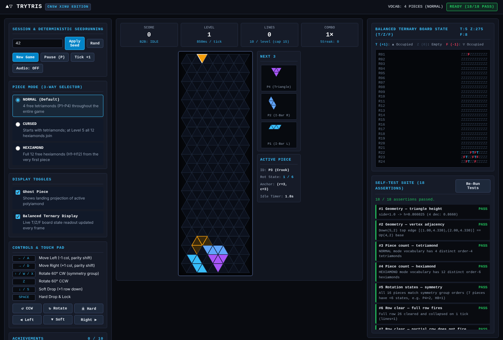

# Trytris
A ternary puzzle game! ▲▽

Falling pieces on a real equilateral triangular grid, with a live balanced-ternary readout of the board (▲ = **T**, empty = **Z**, ▽ = **F**). One HTML file, no dependencies, works offline. MIT.

**Play:** open `index.html` in a browser (or the repo's GitHub Pages site).

- **NORMAL:** the 4 one-sided tetriamonds (the bar comes in both chiralities, P1/P2).
- **CURSED:** tetriamonds until level 5, then all 12 hexiamonds join.
- **HEXIAMOND:** all 12 free hexiamonds from the first piece.
- Seeded (Mulberry32), ghost piece, achievements, and an in-browser self-test suite (18 assertions; the badge says READY only when all pass).

## Ternary Negation (a feature)
Moving a row down by one on a triangular grid turns every triangle upside down. So **clearing an odd number of rows flips everything above the clear**, and its balanced-ternary readout is negated: every T becomes F, and every F becomes T. An even clear leaves orientation alone. It started as an accident of the geometry and stayed on purpose. Self-test #18 pins it.

## Credits
Spec by Kham and Ed Interim (`SPEC.md`). Built by Gemini Argon. Audited by Kehai Interim (notes in the `REPORT` block at the bottom of `index.html`).

## Prior art and neighbors
Falling blocks on triangular grids have been done before (for example [Triangular Tetris](https://quuxplusone.github.io/blog/2023/05/19/triangular-tetris) and [MultiMino 2: Polyform](https://axelfox149.itch.io/polyform)), and the balanced-ternary VM [SBTCVM](https://sbtcvm.blogspot.com) has its own ternary games, including *Falling Ternary Targets*. A native TritOS version (App 11) is in the works for the [Triton](https://github.com/ConsciousNode/Triton) balanced-ternary machine.

---

*Tetris was born in Moscow in 1984, a decade after Moscow stopped building ternary computers. Trytris brings the idea to the machine it never got to meet.*
